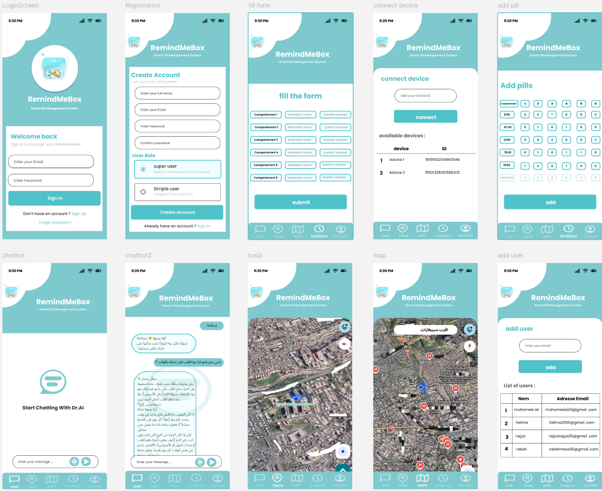

# RemindMeBox

**Smart pill management and elderly safety system.** Developed for the **TSYP 13 – "Power to Empower"** technical challenge (IEEE SSIT/TEMS & SIGHT Tunisia).

RemindMeBox is an ESP32 pill dispenser plus a Flutter app for caregivers. The box dispenses each dose on schedule, checks that the pills were picked up, tracks stock and position, and has an SOS button. A Firebase backend stores the data and pushes alerts to every caregiver's phone. Dr. AI, a Gemini-powered assistant, answers questions about the user's own medication plan.



---

## Architecture

```
 ┌──────────── Smart box (ESP32) ───────────┐        ┌──────────── Firebase ─────────────┐        ┌──── Flutter app ────┐
 │ servo rotor + vacuum pump  (dispensing)  │ HTTPS  │ Cloud Functions                   │        │ Super User / Simple │
 │ IR sensor (pickup)   OLED  LED  buzzer   │◄──────►│  deviceApi   /config /telemetry   │        │ User roles          │
 │ GPS   SOS button   battery sense         │  TLS   │              /events              │        │                     │
 │ local scheduler + offline event queue    │        │  claimDevice  addCaregiver  ...   │◄──────►│ schedule, history,  │
 └──────────────────┬───────────────────────┘        │  monitorDevices (every 5 min)     │ Auth   │ alerts, tracking,   │
                    │ BLE (first-time WiFi setup)    │  onAlertCreated ──► FCM push ─────┼───────►│ hospitals, Dr. AI,  │
                    └────────────────────────────────┤  chatWithAssistant ──► Gemini API │ rules  │ caregivers          │
                                                     │ Firestore (+ security rules), Auth│        └─────────┬───────────┘
                                                     └───────────────────────────────────┘                  │
                                                                         OpenStreetMap tiles + Overpass API ◄┘
```

| Folder | What it is |
| --- | --- |
| [lib/](lib/) | Flutter app: `models/`, `services/` (Firestore, Functions, FCM, BLE, Overpass), `state/session.dart`, `screens/`, `widgets/` |
| [backend/](backend/) | Firebase project: [firestore.rules](backend/firestore.rules), indexes, emulator config, and [Cloud Functions](backend/functions/src/) in TypeScript |
| [firmware/remindmebox_esp32/](firmware/remindmebox_esp32/) | ESP32 Arduino firmware |
| [mechanical_system/](mechanical_system/) | Original IR-sensor alarm prototype (kept for reference) |
| [docs/](docs/) | Report and presentation |

### How a dose flows

1. A **Super User** creates a schedule in the app, e.g. "08:00 every day, 1 × compartment 1 + 1 × compartment 2".
2. The box pulls `/config` every minute and caches it on flash, so it keeps working through WiFi outages.
3. At 08:00 (box time) it dispenses the pills, beeps and blinks, and queues a `dispensed` event.
4. The IR sensor sees a hand over the tray → `taken`. No pickup within the missed-dose delay (30 min by default) → `missed`.
5. Events are uploaded from the queue. The backend records the dose, decrements stock once, and raises alerts (missed dose, low stock, dispensing failure).
6. Each new alert is pushed by FCM to every caregiver of the box.
7. If the box itself goes silent, the **monitor** function marks the dose as missed and raises a "box offline" alert.

Every report about a dose uses the same id, `<scheduleId>_<yyyyMMdd>`, on the box, the server, and the app. Replaying the offline queue therefore never duplicates a dose or its stock change.

### Roles and permissions

| | Super User (owner of a box) | Simple User / caregiver |
| --- | --- | --- |
| Register, sign in, reset password | ✓ | ✓ |
| Connect a box (BLE WiFi setup + pairing code) | ✓ | – |
| Medications, stock, schedules, safe zone, settings | ✓ | read only |
| Today's doses, history, adherence, live location, alerts | ✓ | ✓ |
| Acknowledge alerts, push notifications | ✓ | ✓ |
| Add / remove caregivers by email | ✓ | – |
| Dr. AI chat, nearby hospitals | ✓ | ✓ |

These permissions are enforced on the server by [firestore.rules](backend/firestore.rules) and by the Cloud Functions, not only hidden in the UI. Data the box generates (dose events, alerts, locations) can only be written by the backend.

### Data model (Firestore)

```
users/{uid}                         name, email, role (super|simple), pushIds[]
users/{uid}/messages/{id}           Dr. AI conversation
devices/{deviceId}                  ownerUid, memberUids[], members{}, pendingInvites[], compartmentCount,
                                    name, patientName, timezone, utcOffsetMinutes, settings{missedDoseDelayMin,
                                    lowStockThreshold}, geofence{enabled,lat,lng,radiusM}, location{}, status{lastSeen,
                                    battery, firmware, geofenceInside, ...}
devices/{id}/compartments/{1..N}    medicationName, quantity, notes
devices/{id}/schedules/{id}         time "HH:mm" (box time), days [1..7] (ISO), doses {"1": 2}, label, enabled
devices/{id}/doseEvents/{sid_date}  status dispensed|taken|missed|failed, source device|server, timestamps
devices/{id}/alerts/{id}            type, severity, title, message, acknowledged
devices/{id}/locations/{id}         GPS trail
deviceSecrets/{deviceId}            hashed device secret + pairing code (server only)
invitations/{id}                    caregiver invited before they had an account (server only)
```

---

## Getting started

Prerequisites: Flutter 3.35+, Node.js 22, **Java 21+** (for the Firebase emulators), and the Arduino IDE 2 or arduino-cli for the box.

### 1. Run everything locally (no Firebase account needed)

```bash
cd backend/functions
npm install
npm run serve                  # builds, then starts the Auth + Firestore + Functions emulators (UI on :4000)
```

In another terminal, from the repo root:

```bash
flutter pub get
# Android emulator (reaches your computer through 10.0.2.2):
flutter run --dart-define=USE_FIREBASE_EMULATOR=true
# Physical phone on the same WiFi:
flutter run --dart-define=USE_FIREBASE_EMULATOR=true --dart-define=EMULATOR_HOST=192.168.1.20
```

The bundled [lib/firebase_options.dart](lib/firebase_options.dart) targets the offline `demo-remindmebox` project, which only works against the emulators. Push notifications and Dr. AI need a real project (step 2).

### 2. Use a real Firebase project

1. Create a project in the [Firebase console](https://console.firebase.google.com). Enable **Authentication → Email/Password** and **Firestore**, and switch to the **Blaze plan** (required for Cloud Functions, secrets and outbound calls to Gemini).
2. Connect the app:
   ```bash
   dart pub global activate flutterfire_cli
   flutterfire configure --project=<project-id>      # overwrites lib/firebase_options.dart
   ```
3. Deploy the backend:
   ```bash
   cd backend
   npx firebase use <project-id>
   npx firebase functions:secrets:set GEMINI_API_KEY  # key from https://aistudio.google.com
   npx firebase deploy --only firestore,functions
   ```
   The Gemini model is set in [backend/functions/.env](backend/functions/.env) (`GEMINI_MODEL`).
4. iOS push: upload an APNs key under *Project settings → Cloud Messaging*, and enable the Push Notifications capability in Xcode.

### 3. Build and register a box

Each box gets its own ID, secret and pairing code:

```bash
cd backend/functions
# production (service account JSON with Firestore access):
GOOGLE_APPLICATION_CREDENTIALS=./service-account.json npm run register-device -- --id RMB-0001 --compartments 6 --project <project-id>
# or against the running emulator:
FIRESTORE_EMULATOR_HOST=localhost:8080 npm run register-device -- --id RMB-0001 --compartments 6 --project demo-remindmebox
```

The script prints a `secrets.h` block. Save it as `firmware/remindmebox_esp32/secrets.h` (git-ignored; template in [secrets.example.h](firmware/remindmebox_esp32/secrets.example.h)) and put the pairing code on the box label.

Flash the firmware with the Arduino IDE:

- Board: **ESP32 Wrover Module** (ESP32 Arduino core 3.x). Partition scheme with SPIFFS/LittleFS space, e.g. *Default 4MB with spiffs*.
- Libraries: **ArduinoJson** 7, **U8g2**, **ESP32Servo**, **TinyGPSPlus**.
- Calibrate the servo angles, pump timing and IR threshold in [config.h](firmware/remindmebox_esp32/config.h) for your assembly.

Pin map (from the electrical design):

| Function | GPIO | | Function | GPIO |
| --- | --- | --- | --- | --- |
| Rotor servo | 13 | | IR tray sensor (ADC) | 34 |
| Vacuum pump (MOSFET) | 26 | | Battery sense (ADC, divider) | 35 |
| Buzzer | 25 | | SOS button (to GND) | 27 |
| LED | 2 | | GPS RX / TX (UART2) | 16 / 17 |
| OLED SH1106 SDA / SCL | 21 / 22 | | | |

### 4. Onboard the box in the app

1. Register as a **Super User** → *Connect a box*.
2. *Find boxes nearby*: a new box is in **setup mode** and advertises over Bluetooth. Pick it and send your 2.4 GHz WiFi details. The box joins the network and reboots.
3. Enter the **Device ID** and **pairing code** shown on the box screen → *Connect*.
4. Fill in the medication of each compartment, then add dose times.
5. In the *Users* tab, add caregivers by email. They get access as soon as they register, even if they register later.

On the box: hold the button **2 s** to send an SOS. Hold it **10 s** to forget the WiFi and return to setup mode.

---

## Device API

Base URL: `https://europe-west1-<project-id>.cloudfunctions.net/deviceApi`. Every request needs the header `Authorization: Bearer <deviceId>:<deviceSecret>`.

| Request | Body | Purpose |
| --- | --- | --- |
| `GET /config` | – | `claimed`, `utcOffsetMinutes`, `missedDoseDelayMin`, `serverTime`, `schedules[{id,time,days,doses[{compartment,count}]}]`, `compartments[]` |
| `POST /telemetry` | `{battery, rssi, firmware, lat, lng, accuracy}` | Heartbeat. Drives the online state, the safe-zone check and low-battery alerts |
| `POST /events` | `{events: [...]}` (max 50) | `{"type":"dose","scheduleId","date":"yyyy-MM-dd","time":"HH:mm","status":"dispensed\|taken\|missed\|failed","at":epochSec,"doses":[...]}`, `{"type":"sos","at","lat","lng"}`, `{"type":"error","code","message","at"}` |

---

## Testing

```bash
flutter analyze && flutter test          # app: dose planning, Overpass parsing, widgets
cd backend/functions
npm test                                 # time-zone, dose-state, geo and credential logic
npm run e2e                              # full scenario against the emulators (needs Java 21)
```

`npm run e2e` ([scripts/e2e-emulator.ts](backend/functions/scripts/e2e-emulator.ts)) plays every actor in one run. It registers and claims a box, configures it through the security rules, and simulates the firmware: dispense, take, replayed queue, missed dose, low stock, geofence breach, low battery and SOS. It also invites a caregiver before sign-up, checks rule rejections, runs the missed-dose monitor, and releases the box.

---

## Security notes

- Box ↔ cloud traffic uses HTTPS, pinned to the Google Trust Services roots ([certs.h](firmware/remindmebox_esp32/certs.h)). The backend stores only SHA-256 hashes of device secrets and pairing codes.
- Repeated wrong pairing codes lock claiming for an hour.
- The Gemini API key stays in Secret Manager; the app only talks to the `chatWithAssistant` function, which is rate-limited per user.
- Firestore rules validate every client write (field whitelist, value ranges, owner vs caregiver).

## Known limitations / next steps

- The ESP32 has no battery-backed clock. After a reboot without internet it waits for time sync before dispensing. Adding a DS3231 RTC module removes this limit.
- The firmware has not been run on the assembled hardware yet. Servo angles, pump timing and the IR pickup threshold need calibration ([config.h](firmware/remindmebox_esp32/config.h)).
- Schedule times are in box time; the app assumes caregivers read them in that time zone.
- Planned: OTA firmware updates, biometric verification, a web dashboard for clinics, and localisation (Arabic/French UI).

## Tech stack

Flutter · Firebase (Auth, Firestore, Cloud Functions v2, Cloud Messaging) · Gemini API · OpenStreetMap + Overpass · flutter_map · flutter_blue_plus · ESP32 (Arduino core 3) · ArduinoJson · U8g2
